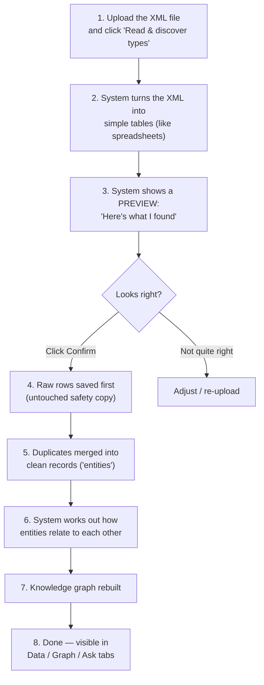

# XML Ingestion Pipeline — Overview

**Date:** 2026-09-16
**What this covers:** the end-to-end flow when a user uploads an XML file
through the web UI's Ingest → Documents tab, reviews the preview, and clicks
Confirm. Every example below uses the actual sample file tested this session,
`SL3500e_Lightweight_Dummy.xml` — a BigMachines/BML CPQ configuration export:

```xml
<bm_config_zip_cache>
  <id>18722413355</id>
  <_children>
    <bm_config_attr><id>4118175</id><variable_name>CRM_CUSTOMER_ID</variable_name>...</bm_config_attr>
    <bm_config_attr><id>5229104</id><variable_name>modelSelectionFrequencyBands_apcr</variable_name>...</bm_config_attr>
    <bm_menu_item><id>998123</id><attr_variable_name>modelSelectionFrequencyBands_apcr</attr_variable_name>
      <variable_name>LB1</variable_name><value><en>Low Band 1 (VHF)</en></value></bm_menu_item>
    <bm_menu_item><id>998124</id><attr_variable_name>modelSelectionFrequencyBands_apcr</attr_variable_name>
      <variable_name>UHF_AMA2</variable_name><value><en>UHF AMA2 Variant</en></value></bm_menu_item>
    <bm_config_attr><id>5229110</id><variable_name>hazardousLocation</variable_name>...</bm_config_attr>
    <bm_config_rule><id>881234</id><variable_name>ruleToConstrainFrequencyBandBasedOnHazmat</variable_name>
      <rule_type>1</rule_type>
      <_children>
        <bm_config_rule_input><attr_var_name>hazardousLocation</attr_var_name>
          <operator>== </operator><property_filter_value>True</property_filter_value></bm_config_rule_input>
        <bm_config_rule_action><attr_var_name>modelSelectionFrequencyBands_apcr</attr_var_name>
          <action_type>1</action_type><restricted_value>UHF_AMA2</restricted_value></bm_config_rule_action>
      </_children>
    </bm_config_rule>
  </_children>
</bm_config_zip_cache>
```

In plain terms, this file says: *"there's a Frequency Band setting with two
choices (Low Band / UHF AMA2), and a rule: if Hazardous Location is checked,
restrict the Frequency Band to not allow UHF AMA2."*

---

## Three words used throughout this doc

- **Table / type** — the *category* of thing, e.g. `BmConfigAttr`. Like saying
  "this is a type of thing called Attribute."
- **Entity** — **one row**, i.e. one specific real thing of that type, e.g.
  the row `id=5229104` is one entity: "the Frequency Band attribute." Not the
  table, not a column — one merged, cleaned-up record.
- **Edge** — a labeled *connecting line* between two entities, e.g. "Rule
  881234 → has_condition_on → Attribute 5229110 (Hazardous Location)." An edge
  holds no data of its own beyond "these two are connected, and how."

---

## The flow



### 1. Upload

You pick the XML file in the "Documents" tab and click "Read & discover
types." The file is just bytes at this point — nothing has been parsed yet.

### 2. Turn into tables — exactly what gets produced

The system walks the XML tree and decides which elements are "real records"
(≥2 different kinds of fields) versus which are just organizational wrapping
(`<_children>`) or translated labels (`<name><en>...</en></name>`). For our
file it produces **six tables** — every element type that qualifies,
including the root element itself:

**`BmConfigZipCache`** (the root — 1 row, no parent, so no FK column):
| id | company_id | segment_id | status | guid |
|---|---|---|---|---|
| 18722413355 | 4118171 | 54 | 1 | bm_prd_family_...bm_config_zip_cache |

**`BmConfigAttr`** (3 rows — direct children of the root's `<_children>`):
| id | variable_name | name | data_type | bm_config_zip_cache_id |
|---|---|---|---|---|
| 4118175 | CRM_CUSTOMER_ID | Customer Id | 1 | 18722413355 |
| 5229104 | modelSelectionFrequencyBands_apcr | Frequency Band | 2 | 18722413355 |
| 5229110 | hazardousLocation | Hazardous Location Environment | 4 | 18722413355 |

**`BmMenuItem`** (2 rows — also direct children of `<_children>`, **siblings**
of `BmConfigAttr`, not nested inside it):
| id | attr_variable_name | variable_name | name | value | bm_config_zip_cache_id |
|---|---|---|---|---|---|
| 998123 | modelSelectionFrequencyBands_apcr | LB1 | LB1 | Low Band 1 (VHF) | 18722413355 |
| 998124 | modelSelectionFrequencyBands_apcr | UHF_AMA2 | UHF_AMA2 | UHF AMA2 Variant | 18722413355 |

**`BmConfigRule`** (1 row — also a direct child of `<_children>`):
| id | variable_name | name | rule_type | description | bm_config_zip_cache_id |
|---|---|---|---|---|---|
| 881234 | ruleToConstrainFrequencyBandBasedOnHazmat | ruleToConstrainFrequencyBandBasedOnHazmat | 1 | Prince: 29May2024 - ... | 18722413355 |

**`BmConfigRuleInput`** (1 row — nested *inside* `BmConfigRule`'s own `<_children>`):
| attr_var_name | operator | property_filter_value | bm_config_rule_id |
|---|---|---|---|
| hazardousLocation | == | True | 881234 |

**`BmConfigRuleAction`** (1 row — also nested inside `BmConfigRule`):
| attr_var_name | action_type | restricted_value | bm_config_rule_id |
|---|---|---|---|
| modelSelectionFrequencyBands_apcr | 1 | UHF_AMA2 | 881234 |

**How each column got there** (3 origins, no exceptions):
1. **A real FK column, injected automatically** (`bm_config_zip_cache_id`,
   `bm_config_rule_id`) — added *only* when an element is structurally
   *nested inside* another one in the actual XML tree. `BmConfigRuleInput`/
   `BmConfigRuleAction` are truly nested inside `BmConfigRule`, so they get
   `bm_config_rule_id`. Everything else here (`BmConfigAttr`, `BmMenuItem`,
   `BmConfigRule` itself) sits directly under the root's own `<_children>`,
   so they all get `bm_config_zip_cache_id` instead — **not** an FK to each
   other, just to their shared parent.
2. **A field copied straight from an XML child element or attribute**
   (`variable_name`, `rule_type`, `attr_var_name`, `restricted_value`, ...) —
   one column per child tag, value taken as-is (or, for the multilingual
   `<name><en>...</en></name>` pattern, the English text is pulled out).
3. **An added `name` column** for human-readability, only when the row didn't
   already have a real `<name>` field — copied from the first useful-looking
   column (`variable_name` is tried first). This is why `BmConfigRuleInput`/
   `BmConfigRuleAction` have **no** `name` column at all: `attr_var_name`
   isn't on the list of fields this aliasing looks for.

**The important part:** `BmMenuItem.attr_variable_name` (`
modelSelectionFrequencyBands_apcr`) and `BmConfigAttr.variable_name` (same
text) are **not** connected by any FK column above — they're structural
siblings, not parent/child. The only thing connecting them is that their text
happens to match. That's exactly the case Step 6 below explains.

### 3. Preview

The UI shows: *"Found 6 types — BmConfigZipCache (1 row), BmConfigAttr (3
rows), BmMenuItem (2 rows), BmConfigRule (1 row), BmConfigRuleInput (1 row),
BmConfigRuleAction (1 row). Confirm to ingest?"* Nothing is saved to the
workspace yet — you're looking at a preview only.

### 4. Confirm → raw rows saved

You click Confirm. Every row from every table above gets written down exactly
as-is — a permanent, untouched copy of what was found. Example: the row
`id=5229104, variable_name=modelSelectionFrequencyBands_apcr` is saved
verbatim, before any cleanup or merging happens.

### 5. Merge duplicates

The system checks: does this same record appear more than once? In this
particular file, nothing actually repeats — but here's a concrete example of
when it *would* kick in, using this same data:

> **Example:** Say this catalog gets re-exported and re-uploaded a week later
> — a common real workflow, not a hypothetical edge case. The new file's
> `BmConfigAttr` table again contains `id=5229104, variable_name=
> modelSelectionFrequencyBands_apcr, name=Frequency Band` — same `id` as
> before, maybe with `name` slightly reworded to `Frequency Band (RF)`.
>
> - **Step 4 (raw save)** writes this as a **second**, brand-new
>   `aryx_landed_record` row — it never overwrites or looks at the first
>   upload's row. Both copies now exist, untouched, side by side.
> - **Step 5 (this step)** then looks at every landed row sharing
>   `id=5229104` and asks "is this the same real thing?" Because `id` is a
>   genuine unique key, this is an exact match — no fuzzy comparison, no
>   guessing — and both rows collapse into **one** `BmConfigAttr` entity, not
>   two duplicate "Frequency Band" attributes cluttering the workspace.
> - If the two copies disagree on a field (`name` = "Frequency Band" vs.
>   "Frequency Band (RF)"), the system has to pick a winner for the merged
>   record — that decision (and which value lost) is itself recorded, so
>   nothing is silently thrown away.
>
> **How the winner actually gets picked** — this runs separately for *each
> field*, not once for the whole record, and there are two layers:
>
> - **If the workspace has a configured merge policy:** one of 5 rules
>   applies, settable per field — `first_non_empty` (whichever copy was seen
>   first), `source_priority` (a named source system always wins, e.g. "trust
>   SAP over the portal"), `most_recent` (newest upload wins), `most_complete`
>   (the copy with more filled-in fields overall wins), `most_frequent` (if 3+
>   copies exist, the most common value wins).
> - **If no policy is configured at all** (the default, unless someone sets
>   one up for the workspace): a simpler *confidence-weighted* merge runs
>   instead — each contributing value is weighted by how confident the system
>   was that the two records were really duplicates, and the highest-weight
>   value wins; on an exact-id-match tie (like this example), that's
>   effectively whichever copy was processed first.
>
> The two layers differ on how visible the loss is: **with a configured
> policy**, the losing value is written to a queryable conflict record (so
> "Frequency Band (RF)" would still be visible in the UI as the value that
> lost). **With no policy configured** (the default), the conflict is only
> written to the backend log, not to a queryable record — the losing value
> still isn't silently gone forever (it's still sitting in its own original
> `aryx_landed_record` row from Step 4), but nothing in the UI surfaces "hey,
> these two values disagreed" unless someone checks the logs.
>
> Matching is only this simple *because* `id` is a real, reliable unique key.
> Fuzzy/guessing-based matching (comparing text similarity instead of an
> exact key) only kicks in for data with no such key — most tables above have
> one, but `BmConfigRuleInput`/`BmConfigRuleAction` don't (no `id`/`guid`
> field in the source XML at all). It doesn't matter for *this* file since
> each of those two tables only has 1 row anyway — nothing to dedupe against
> — but a file with several rule-input rows and no unique key is exactly
> where the fuzzy-matching path would take over instead.

### 6. Work out relationships — this is where it gets interesting

There are two genuinely different *kinds* of connection in this one small
file, found by two different mechanisms:

**Kind A — structural (from the injected FK columns, Step 2), no AI:**
Every `bm_config_zip_cache_id` / `bm_config_rule_id` column is already a
literal, exact value pointing at another table's `id`. The system just looks
it up:

| From | Column = value | Matches | Relationship written |
|---|---|---|---|
| `BmConfigAttr` (×3), `BmMenuItem` (×2), `BmConfigRule` | `bm_config_zip_cache_id = 18722413355` | `BmConfigZipCache.id = 18722413355` | "belongs to" the root config |
| `BmConfigRuleInput` | `bm_config_rule_id = 881234` | `BmConfigRule.id = 881234` | rule → has-input |
| `BmConfigRuleAction` | `bm_config_rule_id = 881234` | `BmConfigRule.id = 881234` | rule → has-action |

This is plain exact-match lookup — **zero AI**, and it was already obvious
the moment the FK column existed.

**Kind B — same real thing, described with a different column name, needs
judgment:** this is the connection that actually matters for understanding
the rule, and it has **no FK column at all**, because (per Step 2) the two
sides are XML *siblings*, not parent/child:

- `BmMenuItem.attr_variable_name = "modelSelectionFrequencyBands_apcr"` ↔
  `BmConfigAttr.variable_name = "modelSelectionFrequencyBands_apcr"` — this is
  what says "LB1 and UHF_AMA2 are the two choices *for* the Frequency Band
  attribute."
- `BmConfigRuleInput.attr_var_name = "hazardousLocation"` ↔
  `BmConfigAttr.variable_name = "hazardousLocation"` — this is what says "the
  rule's condition is *about* the Hazardous Location attribute."
- `BmConfigRuleAction.attr_var_name = "modelSelectionFrequencyBands_apcr"` ↔
  `BmConfigAttr.variable_name = "modelSelectionFrequencyBands_apcr"` — this is
  what says "the rule's action *targets* the Frequency Band attribute."

None of these three share a naming convention (`attr_variable_name` and
`attr_var_name` aren't even spelled the same). So the system asks an AI model
one question — "does `BmMenuItem.attr_variable_name` refer to the same thing
as `BmConfigAttr.variable_name`?" — and once for `attr_var_name` too. Once it
answers yes, matching the actual text values (`"hazardousLocation"` to
`"hazardousLocation"`, etc.) for every row is still plain exact-text
matching, not an AI decision per row.

**Bottom line on the AI's role:** it never invents facts about your data. It's
only ever asked "do these two *columns* represent the same real-world thing?"
— asked once per pair of columns, not once per row — for exactly the cases
where naming alone doesn't make it obvious, like Kind B above. Everything in
Kind A never needed it at all.

### 7. Knowledge graph rebuilt

With all entities and relationships from step 6 known, the system redraws the
full graph for the workspace: nodes for each `BmConfigAttr`/`BmMenuItem`/
`BmConfigRule`/etc., edges for each relationship found.

**Does the graph hold the raw data?** No. Each graph node holds the
**merged/cleaned** entity attributes from Step 5 (`aryx_entity`'s data) — not
the original raw row. Alongside that, each node gets a lightweight
*provenance edge* pointing back to which landed record(s) it came from — but
that's just a pointer (which source system, which dataset, which landed
record id), not a copy of the raw content itself.

| Where | What's actually stored |
|---|---|
| Raw landed table (Step 4) | The full, untouched original row, exactly as parsed — the **only** place the raw content lives |
| Entity (Step 5) | Merged/cleaned attributes only |
| Graph node (Step 7) | The same merged attributes as the entity, plus a *pointer* back to the raw row(s) — not their content |

So if you ever need to see the exact original value something was built
from, you follow that pointer back to the raw landed table — the graph
itself won't show it to you directly.

**Why the *whole* graph, not just the new additions?** The graph isn't the
real data — it's just a *picture* drawn from the real data (the entities and
relationships tables). An "only add what's new" approach can't reliably
handle everything that can change: if Step 5 merges two duplicates into one,
the old separate graph nodes need to disappear, not just get a new node added
alongside them; if a relationship changes or an entity gets deleted
elsewhere, the old edge/node needs to go too. A full rebuild sidesteps all of
that — wipe the graph, redraw it fresh from what the tables *currently* say,
so it can never drift out of sync. The tradeoff is cost, which is exactly why
this only runs **once** per Confirm (after the last file in a batch), not
once per uploaded table — rebuilding it 6 times over and discarding 5 of
those rebuilds would waste that cost for nothing.

**Does new data connect to records from an earlier, separate upload?** Yes —
this is deliberate, not accidental. Step 6's linking mechanisms don't just
look within the current upload; they also check the new data against **every
entity type already in the workspace**:
- The column-naming check explicitly runs "even for single-file confirm
  jobs," matching new columns against ontology types that already existed
  before this upload.
- The AI-assisted matching (`_relate`, the schema-FK inference call) samples
  entities from the **whole workspace**, not just the newly-confirmed batch.

**Concrete example:** if you later upload a *second* BML export into this
same workspace, and it contains a new rule referencing `hazardousLocation`
again, the system checks that against the whole workspace, finds the
`hazardousLocation` attribute entity from *this* upload, and links the new
rule to it — rather than creating a disconnected duplicate.

**The one real boundary: this never crosses workspaces.** Two separate
workspaces (e.g. "Giggso" and "MSI CPQ") never automatically link to each
other's data — only separate uploads *into the same workspace* can connect
like this.

### 8. Done

The ingested data is now browsable in the Data tab, visible in the Graph tab,
and queryable through Ask — e.g. asking "what happens to Frequency Band when
Hazardous Location is set?" should be answerable from the rule captured here.

---

## Key files, for reference

| Concern | File |
|---|---|
| Upload + discovery endpoints | `src/aryx/api/doc_discover/doc_discover_api.py` |
| XML → table parsing | `src/aryx/pipeline/doc_discovery/doc_discovery_xml.py` |
| Orchestrates one file's pipeline run | `src/aryx/pipeline/orchestrate.py` |
| Merging duplicates into entities | `src/aryx/resolution/run.py`, `src/aryx/store/entity_store.py` |
| Relationship building — deterministic join | `src/aryx/pipeline/fk_edges.py` (`link_by_attribute`) |
| Relationship building — AI-assisted matching | `src/aryx/pipeline/enrich/`, `src/aryx/relationships.py` |
| Graph rebuild | `src/aryx/project/project_full.py` |
