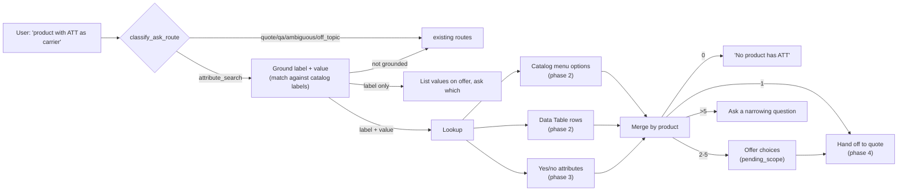

# CPQ attribute-first product discovery — plan and change log

**Branch:** `feat/cpq-attribute-search-route-2026-10-02` (from `dev_oci`)
**Flag:** `ARYX_CPQ_ATTR_SEARCH_ENABLED` — off by default
**Status (2026-10-02):** Phases 1–3 done · Phase 4 built, verification pending · Phase 5 not started

## 1. What this adds

Today a CPQ conversation has to start from a product ("I want to order APX
Next radios…"). This feature lets a user start from an attribute instead:

- "I want a product that has ATT as a carrier" — attribute **and** value
- "Which products are available for carrier selection" — attribute only

The backend finds which product(s) offer that attribute value, settles on
one, and then continues as a normal quote for that product, with the value
already filled in.

### Target flow

### Decisions taken (Andie session, 2026-10-02)

| # | Decision |
|---|---|
| 1 | New first-turn router route `attribute_search`. The model copies the attribute and value as typed; our code matches them to real catalog labels (the model never invents label names). |
| 2 | Both question shapes are supported: label + value, and label only (bot asks which value). |
| 3 | Lookup sources: catalog menu options and Data Table rows (phase 2), plus yes/no attributes (phase 3). Menu options were added after the real-data check showed most values live there; the planned rule index was dropped after a probe showed rules add nothing the menus don't already cover. BML scripts are out of scope for v1 (they compute values at run time and can't be run backwards). |
| 4 | 1 match → pick automatically · 2–5 → offer choices · more than 5 → ask a narrowing question. Cap = 5. |
| 5 | If the message also names a product, the **product wins** and the message is a normal quote. |
| 6 | Hand-off sets the product, fills in the attribute value only if that product's rules allow it, and carries any quantity/country from the first message. |

## 2. Phases at a glance

| Phase | What | Status |
|---|---|---|
| 1 | Router route + attribute/value extraction | ✅ Done |
| 2 | Ground the label, look up products (catalog menu options + Data Table), answer with the list | ✅ Done |
| 3 | Yes/no attributes (replaced the planned rule index) | ✅ Done |
| 4 | Pick the product (1 / 2–5 / >5) and hand off into the quote | 🟡 Built and tested on real data; regression run pending |
| 5 | Golden/benchmark cases | ⬜ Not started (unit tests are written with each phase) |

Phases 1–4 together make a usable v0.

## 3. Phase 1 — router route (done)

**Goal:** the top-level router recognises an attribute-first message and
returns the attribute and value the user typed.

**Changes**

- New route value `attribute_search` on `AskRoute`, with two new fields on
  `AskRouteDecision`: `attribute_label` and `attribute_value`. Both are raw,
  unvalidated model output — same rule as the existing `quantity`/`country`.
- The extra prompt text (route description, three few-shot examples, and the
  "product wins" rule) and the extra schema fields live in a new module and
  are added to the prompt **only when the flag is on**. With the flag off the
  prompt and schema are byte-for-byte what they were.
- `_parse_route` accepts `attribute_search` only when the flag is on. It also:
  - downgrades `attribute_search` with no label to `quote` (what it was before);
  - downgrades low-confidence `attribute_search` to `ambiguous`, like quote/qa;
  - type-checks both fields, failing closed to `None`.
- `attribute_search` counts as a CPQ route for the deterministic auditor's
  agreement check (`map_route_to_det_expectation`).
- The flag check is a strict `is True`, so a `MagicMock` settings object in
  tests can't switch it on by accident.
- `run_ask` (llm_first mode) gained an `attribute_search` branch. In phase 1
  it sent the message down the normal quote path; phase 2 replaced that with
  the handler (see below).

**Files**

| File | Change |
|---|---|
| `src/aryx/cpq/intent_gateway/intent_gateway_attr_route.py` | **New** (98 lines). Schema fields, prompt line, few-shots, rule text, `is_enabled()`, `extend_schema()`, `parse_attr_fields()`. |
| `src/aryx/cpq/intent_gateway/intent_gateway.py` | `AskRoute` literal; two new `AskRouteDecision` fields; `_parse_route(..., allow_attribute_search=)`; flag-gated prompt/schema in `classify_ask_route`; agreement check now uses `map_route_to_det_expectation`; attribute fields added to the `cpq_ask_route` log line. |
| `src/aryx/api/ask_run_ask.py` | `attribute_search` dispatch branch. |
| `src/aryx/config/config_cpq_intent.py` | New setting `cpq_attr_search_enabled` (`ARYX_CPQ_ATTR_SEARCH_ENABLED`, default `False`). |
| `tests/test_cpq_attribute_search_route.py` | **New**, 16 tests. |

**Verification:** 16 new tests pass. The 17 existing router/intent test files
(288 tests including the new ones) all pass — about 18 minutes, as many make
real LLM calls.

## 4. Phase 2 — grounding and product lookup (done)

**Goal:** turn "carrier" + "ATT" into a list of real products. Works for any
attribute, not only carrier.

### What the real catalog showed (workspace 704, 2026-10-02)

The original plan was to search the Data Table only. A read-only check on
workspace 704 showed that would find nothing for carrier:

- `attrToVarMapping` has only 19 labels (Antenna Type, Battery Type, Feature
  Type, …) — **no carrier label**.
- None of the 6,422 constraint rows mention a carrier attribute.
- The carrier values are **menu options on the catalog's configuration
  attributes**: "Carrier Selection" (`carrierSelectionMultiSelect_astro`) and
  "Wireless Carrier" (`wirelessCarrier_astro`) in family `aSTRO25_bom`, with
  options such as `ATT/FIRSTNET = ATT/FirstNet (provided by Motorola)`.

So phase 2 searches **two sources** and merges them by product:

| Source | Grounds the phrase against | Matches the value against | A hit's "product" is |
|---|---|---|---|
| Catalog menu options (new) | each family's configuration-attribute labels | the attribute's menu options (value code and display name, whole-word) | the product family, e.g. `aSTRO25_bom` |
| Data Table | `attrToVarMapping` labels | constraint rows (`search_products_by_feature`, substring) | the CPQ model |

The menu-option source is the one that finds most real values. A family is
also exactly what phase 4 needs to start a quote from.

### Changes

- **Grounding** (`ground.py`, no LLM). Matches the user's phrase to real labels
  by words, ignoring case, plurals and filler words:
  - exact same words → best (`"carrier selection"` → `Carrier Selection`);
  - every phrase word is in the label (`"carrier"` → `Carrier Selection`, `Wireless Carrier`);
  - every label word is in the phrase (`"region code"` → `Region`).

  Only labels with the best score are kept (max 5). Value spellings: as typed,
  plus without punctuation (`AT&T` → `AT&T`, `ATT`).
- **Menu-option source** (`menu_source.py`). For each ingested family, loads its
  configuration (`CpqEngine.load_product_config`), grounds the phrase against
  the attributes that have menu options, and keeps the options matching the
  value. A family that fails to load is skipped.
- **Snapshot cache** (in `menu_source.py`). Loading one family's configuration
  takes 10–17 s on workspace 704, so each family's (label, variable, options)
  snapshot is cached per workspace for 5 minutes and cleared when the catalog is
  re-ingested — same lifetime and re-ingest marker as the existing
  `attrToVarMapping` cache. Failed loads are not cached.
- **Data Table source** (`lookup.py` + new `list_attribute_role_labels()`). Runs
  `search_products_by_feature` for every grounded label × value spelling.
  Called directly rather than through `search_products_combined`, which adds a
  graph lookup per model that isn't used here.
- **Lookup** (`lookup.py`) merges both sources by product (labels, attributes,
  values, base models, sources). It returns `None` only when **neither** source
  recognises the phrase.
- **Handler** (`ask_attribute_search.py`) answers:
  - one product: "aSTRO25_bom offers Carrier Selection and Wireless Carrier: ATT/FirstNet (provided by Motorola)."
  - several: "2 products offer Carrier Selection 'ATT': APX1000, APXNEXT." (list capped at 20);
  - none: "I couldn't find any product with Carrier Selection or Wireless Carrier 'Sprint'.";
  - label only: "Products offer these Carrier Selection options: …. Which one do you need?" (capped at 10).

  The full result is also in `cpq_payload.attribute_search_results`. If the
  phrase isn't recognised, or the lookup raises, it returns `None` and `run_ask`
  falls back to the normal quote path. Session state is not changed in phase 2.

### Files

| File | Change |
|---|---|
| `src/aryx/cpq/attribute_search/__init__.py` | **New** package. |
| `src/aryx/cpq/attribute_search/ground.py` | **New** (77 lines). `ground_attribute_label()`, `value_variants()`. |
| `src/aryx/cpq/attribute_search/menu_source.py` | **New**. `search_menu_options()`, `option_matches()`, snapshot cache, `clear_menu_cache()`. |
| `src/aryx/cpq/attribute_search/lookup.py` | **New**. `AttributeSearchResult`, `find_products_by_attribute()` (both sources). |
| `src/aryx/api/ask_attribute_search.py` | **New**. `_route_attribute_search()` and answer wording. |
| `src/aryx/cpq/data_table/data_table_product.py` | New `list_attribute_role_labels()`. |
| `src/aryx/cpq/data_table/__init__.py` | Exports `list_attribute_role_labels`. |
| `src/aryx/api/ask_run_ask.py` | The branch calls the handler; falls back to the quote path only when it returns `None`. |
| `src/aryx/config/config_cpq_intent.py` | Flag description updated. |
| `src/aryx/cpq/intent_gateway/intent_gateway_attr_route.py` | Docstring updated. |
| `tests/test_cpq_attribute_search_lookup.py` | **New**, 15 tests (grounding + Data Table lookup). |
| `tests/test_cpq_attribute_search_menu_source.py` | **New**, 12 tests (menu matching, families, cache, re-ingest, expiry). |
| `tests/test_cpq_attribute_search_handler.py` | **New**, 12 tests (answers + `run_ask` dispatch). |
| `tests/test_cpq_attribute_search_route.py` | The `run_ask` test stubs the handler and covers the ungrounded fallback. |

### Verification

- **Unit tests:** 55 attribute-search tests pass.
- **Regression:** 455 tests across the router, intent, `ask_api` and Data Table
  test files: 452 pass, 3 fail. The 3 failures are in
  `tests/test_cpq_auto_fill_data_table_tier.py` and **fail identically on a
  clean `dev_oci`** (`cac516f9`) — pre-existing, not caused by this work.
  The affected files were re-run after the final phase 2 edits: 107 pass.
- **Real data, workspace 704** (branch code run read-only inside the local
  `aryx_oci-api-1` container):

  | Question | Result | Time |
  |---|---|---|
  | carrier / ATT | `aSTRO25_bom` — ATT/FirstNet (provided by Motorola) | 52.6 s (cold) |
  | carrier / AT&T | same | 0.6 s |
  | carrier selection (no value) | lists the 6 carrier options, asks which | 0.5 s |
  | carrier / T-Mobile | both T-Mobile options | 0.5 s |
  | wireless carrier / Verizon | the Verizon option | 0.5 s |
  | battery type, antenna, frequency bands, encryption (no value) | each lists its options | 0.5 s |
  | encryption / "No" | the "No ADP…" / "No Encryption" options | 0.5 s |
  | language / Spanish | "couldn't find any product…" (correct) | 0.5 s |
  | colour / red, camera | not recognised → normal quote path | 0.5 s |

  107 attributes in `aSTRO25_bom` and 30 in `videoSolutions_BOM` have menu
  options and are searchable.

### Known limitations (carried forward)

1. **Cold start:** the first question after a restart takes ~50–75 s (mostly the
   existing `attrToVarMapping` scan, plus loading each family once). After that
   ~0.5 s. Flag stays off until this is addressed (e.g. warm the caches at
   startup).
2. **Short phrases can match broadly:** "battery" grounds to Battery Type,
   Battery Refresh Service and "Include a Battery Subscription?".
3. **Not covered yet:** attributes with no menu options (free text, yes/no), and
   values that only come from rules or BML (phase 3).
4. **No follow-up memory:** after "Which one do you need?", the user's reply
   arrives as a fresh first turn. Phase 4 adds the pending state.

## 5. Phase 3 — yes/no attributes (done; replaces the planned rule index)

### Why the plan changed

Phase 3 was planned as a rule-based value → product index. A read-only probe
of workspace 704's rules showed it would add almost nothing:

| | aSTRO25_bom | videoSolutions_BOM |
|---|---|---|
| Rules in total | 686 | 163 |
| Written as BML scripts (out of scope for v1) | 565 (82%) | 144 (88%) |
| Plain-value rules | 116 | 19 |
| Rule values phase 2 already finds as menu options | 72 | 18 |
| Rule values that aren't menu options | 52 | 6 |

All 58 values in the last row are `true`/`false` on yes/no attributes — mostly
internal flags ("Is Item Type EARPIECE SMALL RIGHT", "BulkAddFlag", "Edit"),
plus a few real features ("Enable Dual Active Sim?", "Include a Spare Battery
with each body camera"). The real gap was **yes/no attributes**, which have no
menu options and were skipped by phase 2. Decision (2026-10-02): phase 3 =
yes/no attribute support; the rule index is dropped unless rule values outside
the menus show up on another workspace.

### Changes

- **Yes/no attributes are searchable.** A family "offers" a yes/no feature when
  it has the attribute. With no value, or a yes word (yes, true, enabled, with,
  include…), it's a "Yes" hit; a no word gives a "No" hit; any other value
  ("ATT") doesn't match a yes/no attribute.
- **Menus of only Yes/No options count as yes/no features too** (e.g.
  'Is this a "SPARE radio"', "Data Cable"). They are real customer-facing
  questions, so no flag filtering applies to them.
- **Internal flags are left out** (true yes/no attributes only): labels starting
  with "Is" ("Is Item Type …", camelCase "isRelatedService…"), labels ending in
  "Flag", and single-word names ("BoolContinue1", "Edit").
- **Hidden attributes are never searchable** — they aren't offered to the
  customer. This also applies to attributes with menu options (a small change
  to phase 2 behaviour).
- **Feature answers.** When every hit is a yes/no attribute the result is marked
  `feature_only` and the answer lists products instead of asking "Yes or No?":
  - "aSTRO25_bom offers Enable Dual Active Sim?"
  - "2 products offer Include a Spare Battery with each body camera, Include a Spare? or Is this a "SPARE radio": aSTRO25_bom, videoSolutions_BOM."
- **Grounding is global.** The phrase is grounded once across every family's
  labels, and the final labels are re-grounded across both sources (menus and
  Data Table), so a loose match ("Data Cable") never sits beside an exact one
  ("Include USB-C Data and Charge Cable in-box"). Hits under dropped labels are
  removed.
- **New module** `searchable.py` holds the "which attributes are searchable"
  rules, so `menu_source.py` stays under the 150-line limit.

### Files

| File | Change |
|---|---|
| `src/aryx/cpq/attribute_search/searchable.py` | **New** (74 lines). `searchable_entry()`, `yes_no()`, `option_matches()` (moved from `menu_source.py`), flag filter. |
| `src/aryx/cpq/attribute_search/menu_source.py` | Snapshot now holds yes/no attributes; global grounding across families; hits carry `kind` ("option" / "boolean"). |
| `src/aryx/cpq/attribute_search/lookup.py` | `AttributeSearchResult.feature_only`; final labels re-grounded across both sources. |
| `src/aryx/api/ask_attribute_search.py` | Feature-style answers when `feature_only`. |
| `tests/test_cpq_attribute_search_menu_source.py` | +10 tests (yes/no hits, yes/no words, flag filter, yes/no menus, hidden, global grounding) — 22 total. |
| `tests/test_cpq_attribute_search_lookup.py` | +3 tests (`feature_only`, cross-source grounding) — 18 total. |
| `tests/test_cpq_attribute_search_handler.py` | +2 tests (feature answers) — 14 total. |

### Verification

- **Unit tests:** 70 attribute-search tests pass.
- **Regression:** 484 tests across the router, intent, `ask_api` and Data Table
  test files: 481 pass, 3 fail — the same 3 pre-existing failures in
  `tests/test_cpq_auto_fill_data_table_tier.py` that also fail on a clean
  `dev_oci` (see phase 2).
- **Real data, workspace 704:** `aSTRO25_bom` has 112 searchable attributes
  (33 yes/no), `videoSolutions_BOM` 29 (8 yes/no).

  | Question | Answer |
  |---|---|
  | dual active sim | aSTRO25_bom offers Enable Dual Active Sim? |
  | spare battery | videoSolutions_BOM offers Include a Spare Battery with each body camera. |
  | TAA compliant / yes | aSTRO25_bom offers TAA Compliant. |
  | spare | 2 products offer … : aSTRO25_bom, videoSolutions_BOM. |
  | smartdock configuration service | videoSolutions_BOM offers SmartDock Configuration Service (No Video Storage). |
  | usb-c data and charge cable | videoSolutions_BOM offers Include USB-C Data and Charge Cable in-box. |
  | carrier / ATT, carrier selection, battery type / standard | unchanged from phase 2 |

### Known limitations

- A few UI-action yes/no attributes ("Save Changes", "Cancel All Lines",
  "Retrieve Prov Agencies") still pass the filter. Harmless in practice — a
  user is unlikely to search by them.
- Yes/no menus aren't flag-filtered, so a flag-named menu like
  "getDataFromCookieFlag" is searchable. Same reasoning.
- Cold start still applies; a phrase that first touches the Data Table loads
  its constraint tables (~40 s on workspace 704).

## 6. Phase 4 — choose the product and start the quote (done; verification pending)

### What happens now

| Search result | What the customer sees | Session afterwards |
|---|---|---|
| 1 family | "aSTRO25_bom offers Carrier Selection and Wireless Carrier: ATT/FirstNet (provided by Motorola)." followed by the normal quote flow's next question | `product_name` set, matched value(s) filled in |
| 2..N families (N = `ARYX_CPQ_ATTR_SEARCH_MAX_CHOICES`, default 5) | "2 product families offer …: 1. A 2. B. Which one would you like to quote?" | `pending_anchor="product"` + `product_suggestions` scope; values remembered per family |
| more than N | "7 product families offer …, including A, B, C, D, E and 2 more. Which product family would you like to quote?" | same as above |
| no value, not a yes/no feature | "Products offer these Carrier Selection options: …. Which one do you need?" | `pending_attribute_label` set |
| only Data Table models, or nothing | the phase 2 list answer | unchanged |
| the message names a product | — (normal quote path; the product wins) | — |

### Changes

- **Starting the quote** (`ask_attribute_handoff.start_quote`). Builds a fresh
  `CpqSession` with `product_name` = the family, the original message as
  `product_anchor_question`, quantity and country from the first message, and
  the matched values filled in; then calls the normal `_route_quote`. Its
  answer is prefixed with what was found.
- **Filling in values** (`cpq/attribute_search/seeds.py`). Written the way the
  engine's own hint matching writes them: multi-select into `filled_multi`,
  others into `filled`, true yes/no attributes as `"true"`/`"false"`, yes/no
  menus as their own Yes/No code; `filled_source="hint"`. The engine's existing
  constraint check (`tier0_already_filled`) still re-validates each value and
  drops it if that product's rules don't allow it.
- **Which values get filled in** (`trim_ambiguous_seeds`, decided 2026-10-02):
  - a stated value that matched a real menu option is evidence, so **every**
    attribute offering it is filled ("ATT" fills both Carrier Selection and
    Wireless Carrier);
  - a yes/no feature found only by its label is filled **only if exactly one**
    feature attribute matched in that family. "includes a spare" matched
    "Include a Spare?" and two 'Is this a "SPARE radio"' attributes in
    `aSTRO25_bom`, so none is filled there and the quote asks as usual;
    `videoSolutions_BOM` has one match, so its value is filled.
  - A family with nothing to fill in is still offered and still starts its quote.
- **Search hits carry the code to store** (`item_value`) and `select_type`;
  each product in the result carries its `seeds` (catalog-menu hits only).
- **Offering families** (`offer_families`, `ask_for_family`). Reuse the existing
  "which product family?" mechanism — `pending_anchor="product"` with a
  `product_suggestions` scope — so step 1's existing reply matching (number,
  name, fuzzy) picks the family. The values for each family are kept in the new
  session field `attribute_search_seeds`; **step 1 fills them in** for the family
  picked, then clears the field.
- **Asking for the value** (`ask_for_value`). Stores the attribute in the new
  session field `pending_attribute_label`. On the next turn `run_ask` sends the
  reply to `ask_attribute_followup.py`, which matches it against the values on
  offer (number, exact, partial, fuzzy — the same in-scope matching as any "did
  you mean" list) and continues as if the first message had named that value.
  If the reply isn't one of the values (the customer moved on), the pending
  attribute is cleared and the reply is routed normally.
- **"Product wins" in code.** Before searching, the handler checks
  `detect_product_mention` and `resolve_product_hint`; if the message names a
  product it returns `None` and the normal quote path handles it.
- New setting `cpq_attr_search_max_choices` (`ARYX_CPQ_ATTR_SEARCH_MAX_CHOICES`,
  default 5).

### Files

| File | Change |
|---|---|
| `src/aryx/api/ask_attribute_handoff.py` | **New** (117 lines). `start_quote`, `offer_families`, `ask_for_family`, `ask_for_value`. |
| `src/aryx/api/ask_attribute_followup.py` | **New** (58 lines). `_route_attribute_followup()`. |
| `src/aryx/api/ask_attribute_search_answers.py` | **New** (61 lines). Answer wording, moved out of the handler. |
| `src/aryx/cpq/attribute_search/seeds.py` | **New**. `seed_values()`, `apply_pending_seeds()`, `trim_ambiguous_seeds()`. |
| `src/aryx/api/ask_attribute_search.py` | Rewritten as the decision step (`decide()`), "product wins" check, max-choices setting. |
| `src/aryx/cpq/attribute_search/searchable.py` | Entries keep `select_type` and yes/no menu options; new `boolean_code()`. |
| `src/aryx/cpq/attribute_search/menu_source.py` | Hits carry `item_value` and `select_type`. |
| `src/aryx/cpq/attribute_search/lookup.py` | Products carry `seeds`. |
| `src/aryx/cpq/state/__init__.py` | New `CpqSession` fields `pending_attribute_label`, `attribute_search_seeds`. |
| `src/aryx/api/ask_turn_steps/ask_step1_product_anchor.py` | Fills in the remembered values when a family is picked (+5 lines). |
| `src/aryx/api/ask_run_ask.py` | Sends a reply to a pending "which value?" question to the follow-up. |
| `src/aryx/config/config_cpq_intent.py` | New `cpq_attr_search_max_choices`. |
| `tests/test_cpq_attribute_search_seeds.py` | **New**, 13 tests (incl. ambiguous-feature trimming). |
| `tests/test_cpq_attribute_search_handoff.py` | **New**, 13 tests. |
| `tests/test_cpq_attribute_search_followup.py` | **New**, 9 tests (follow-up, `run_ask` hook, step 1 fills values). |
| `tests/test_cpq_attribute_search_menu_source.py`, `…_handler.py` | Updated for the new hit fields and the product check (25 and 14 tests). |

### Verification

- **Unit tests:** 108 attribute-search tests pass.
- **Regression:** running.
- **Full conversations on workspace 704.** Run read-only inside the local
  container with chat-history writes stubbed. The container's OCI GenAI
  credentials are malformed (`tenancy`/`user`/`fingerprint` "malformed"), so
  every LLM call fails there; the router's answer for each first message was
  replayed, and everything else — catalog lookups, hand-off, the CPQ engine — ran
  for real.

  | Conversation | Result |
  |---|---|
  | "I want a product that has ATT as a carrier" | Quote started for `aSTRO25_bom`, Carrier Selection (multi) and Wireless Carrier both filled with ATT/FIRSTNET, then "what's the destination country?" |
  | → "United States" | Values kept; engine asks its normal product-line question (aPXN70_BOM / aPXNext_BOM) |
  | "Which products are available for carrier selection" | Lists the 6 carrier options, asks which |
  | → "ATT" | Quote started for `aSTRO25_bom` with Carrier Selection filled in |
  | "I need a product that includes a spare" | Offers 1. aSTRO25_bom 2. videoSolutions_BOM |
  | → "1" | `aSTRO25_bom` picked; nothing filled in, because three spare attributes matched there (see "Which values get filled in") |
  | "I want APX Next radios with ATT as the carrier" | Product wins — normal quote path |

### Known limitations

1. ~~Broad phrases over-fill.~~ Fixed: ambiguous yes/no features are no longer
   filled in (see "Which values get filled in"). A broad phrase can still *offer*
   more families than the customer meant.
2. **First-turn speed:** first question ~75 s on a cold start; the CPQ turns
   themselves take 20–35 s here (the engine's own work, plus failing LLM calls).
3. When the product is named (case D), the carrier in the same message isn't
   pre-filled — that's the existing quote path's behaviour, unchanged.

## 7. Phase 5 — golden cases (planned)

Add positive, negative and multi-match cases to
`benchmarks/cpq_intent/CPQ_REGRESSION_SUITE.md`. Note: that suite's live mode
calls `classify_intent` with the wrong arguments today, so it can't measure
LLM accuracy until that's fixed.

## 8. Risks

| # | Risk | Mitigation |
|---|---|---|
| 1 | ~~`attrToVarMapping` may not contain a carrier label.~~ Confirmed on workspace 704: it doesn't. | Resolved in phase 2 by the catalog menu-option source. |
| 2 | Values are stored as composites (`ATT/FIRSTNET`); users type `AT&T`, `FirstNet`. | Substring match + punctuation-free spelling now; an alias list later if needed. |
| 3 | "ATT" might also match a product name. | Product wins (decision 5), enforced in code in phase 4. |
| 4 | First-turn latency on a cold cache: ~50–75 s measured on workspace 704; ~0.5 s once cached. | Snapshot + label caches; flag-gated. Warm the caches at startup before enabling. |
| 5 | ~~Rule index goes stale after re-ingest.~~ | No longer applies — rule index dropped. Menu snapshots are cleared on re-ingest. |

## 9. Style notes

- New source files are all under 150 lines.
- Existing files that were already over the limit get small edits only:
  `intent_gateway.py`, `data_table_product.py`, `config_cpq_intent.py`,
  `cpq/state/__init__.py`, `ask_step1_product_anchor.py` (152 → 157) and
  `ask_run_ask.py` (163 → 190).
- Some test files are over 150 lines (see `wc -l tests/test_cpq_attribute_search_*.py`);
  they can be split if the style gate requires it.
- No new libraries.
